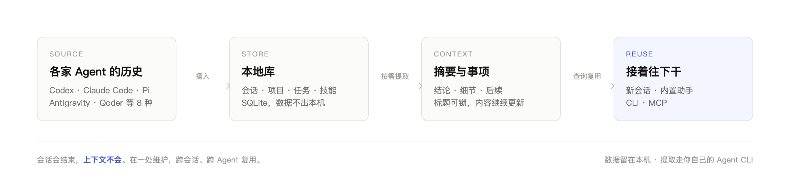
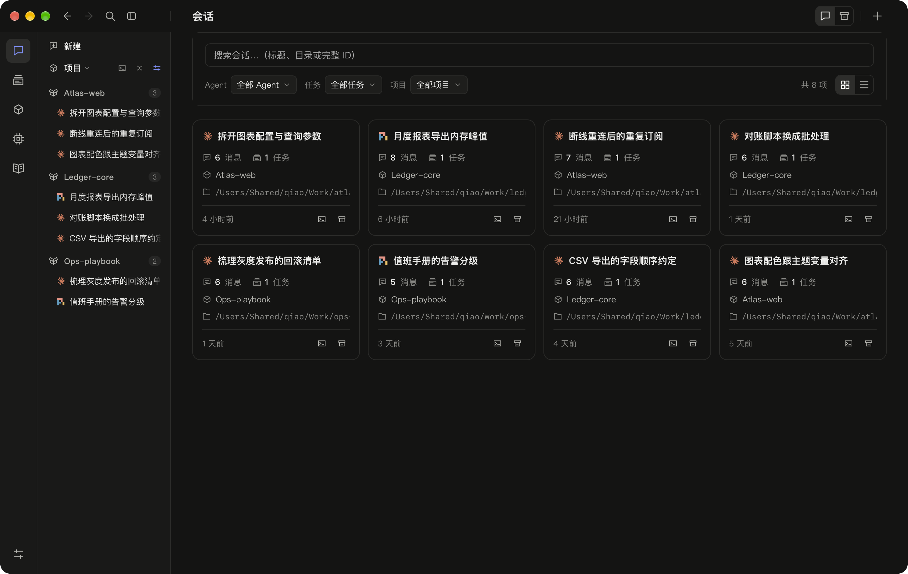
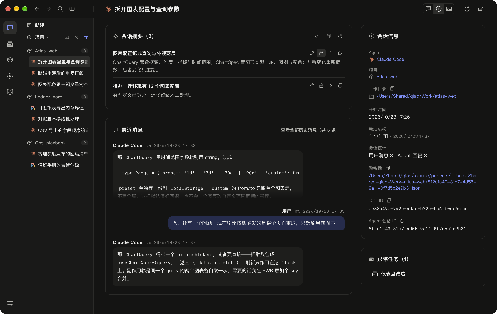

<div align="center">
  <picture>
    <source media="(prefers-color-scheme: dark)" srcset="docs/assets/banner-dark.png">
    <source media="(prefers-color-scheme: light)" srcset="docs/assets/banner-light.png">
    
  </picture>
</div>

面向 macOS 和 Windows 的**本地多 Agent 工作空间**。把分散在不同 Agent 中的会话、项目和任务放到一起，让你找回之前的讨论、继续未完成的工作，并在不同会话和 Agent 之间延续上下文。

## 为什么需要它

每个 Agent 都攒着自己的历史，各自的续接命令只回到本会话。上周定下的结论，换个 Agent 就得重新讲一遍；换个项目，连找都找不到。

NoEnding 把这条链路收敛到一处：



会话会结束，上下文不会。

## 能做什么

- **集中管理会话**：阅读和查找不同 Agent 的本地历史，在内嵌终端或对应桌面应用中继续工作。
- **围绕项目和任务协作**：组织 Git 仓库、worktree 和普通目录；一个任务可关联多个项目，一个会话可跟踪多个任务。
- **积累工作上下文**：按需整理会话、任务和项目的事项摘要，保留结论、细节与后续；支持逐项编辑和增删，锁定重要事项的标题，同时允许内容继续更新。
- **统一管理技能**：发现本地 Skill，选择迁移到 NoEnding 技能库或引用原目录，按 Agent 配置用户级和项目级启用范围。
- **使用独立助手项目**：在空白助手项目中与 Agent 开展工作，按需启用记忆、协作和信箱技能。
- **让 Agent 使用上下文**：通过独立 CLI 或 MCP 访问同一份本地数据，查询记忆覆盖状态、检索历史和更新摘要，无需保持桌面应用运行。

会话历史和工作数据保存在本机；AI 摘要提取通过你自己的 Agent CLI 执行。



## 快速开始

工程基于 Tauri 2、React、TypeScript、Rust 和 SQLite。准备 Node.js 20、pnpm 9、Rust stable，以及对应平台的 Tauri 2 构建工具。

```bash
git clone https://github.com/jqwan/noending.git
cd noending
pnpm install --frozen-lockfile
pnpm tauri dev
```

`pnpm tauri dev` 同时启动前端开发服务和桌面应用，无需另行配置数据库服务。需要新建会话、继续 CLI 会话或提取摘要时，安装对应 Agent CLI，并完成其自身的模型配置与登录。

生成安装包：

```bash
pnpm tauri build
```

构建产物位于 `src-tauri/target/release/bundle/`。前端单独构建使用 `pnpm build`；桌面窗口与打包配置见 [tauri.conf.json](src-tauri/tauri.conf.json)，开发约定见 [AGENTS.md](AGENTS.md)。

## 支持的 Agent

| Agent | 新建会话 | 继续会话 |
| --- | --- | --- |
| Codex | ✓ `codex` CLI | CLI 或 Codex 桌面端 |
| Claude Code | ✓ `claude` CLI | CLI |
| Pi | ✓ `pi` CLI | CLI |
| Antigravity | ✓ `agy` CLI | CLI 会话用 CLI；IDE 会话打开应用 |
| Qoder | — | 打开 Qoder 应用 |
| WorkBuddy | — | 桌面端定位到会话 |
| DSH | — | 打开 DeepSeek Harness 应用 |
| ZCode | — | 打开 ZCode 应用 |

以上 Agent 均支持历史摄入。「打开应用」表示打开对应桌面应用，不自动定位会话。新建需要安装对应 CLI，桌面端继续需要安装对应应用。

## 用起来

1. **接入历史**：在「Agent」查看安装情况、检测 CLI，并管理会话来源目录。
2. **开启工作**：在「新会话」选择项目、工作目录和 Agent，可选跟踪任务，并按 Agent 能力选择模型与思考等级。输入首条消息后发送，也可留空直接打开终端。
3. **找回上下文**：在会话、任务或项目详情中阅读摘要，按需「更新摘要」或「重新生成」。
4. **管理技能**：在「技能」看板托管本地 Skill，并配置启用范围；项目详情也可管理项目技能。
5. **使用助手**：在「新会话」选择 NoEnding Assistant 项目，以 Codex、Claude Code 或 Pi 开始对话。
6. **整理工作空间**：项目、任务和会话可独立归档或取消归档，永久删除按界面条件执行。

<details>
<summary>细节与边界</summary>

- **接入历史**：默认来源和手动添加的来源都会参与自动同步，也可按全部来源、Agent 或单个来源手动同步。
- **开启工作**：长内容可在终端中输入。从 NoEnding 新建或继续的终端 Agent 会话默认使用完全访问权限。
- **找回上下文**：在「设置」选择提取使用的 Agent、模型和提示词；标题锁只保护事项标题，描述和细则仍可更新。
- **管理技能**：引用的源目录若本身就在 Agent 生效路径，该物理入口会保持启用，其他链接入口可正常启停。
- **使用助手**：助手项目默认为空，不附带说明文件、CLI 入口或预设技能，可自行配置。
- **整理工作空间**：删除只清理 NoEnding 本地数据，保留 Agent 源文件；后续同步可能重新摄入这些会话。

</details>

### 查找

使用顶部「查找」（macOS `⌘K`、Windows `Ctrl+K`），按名称查找项目、任务、会话、Agent 或技能；项目和会话也可按目录匹配。此入口用于定位对象，历史消息正文和摘要事项可通过 CLI/MCP 检索。

### 同步与摘要

历史同步与摘要更新分开进行：同步负责获取会话消息，摘要按需整理。桌面应用启动时会同步，回到前台后按检查间隔补充同步；普通查询不会自动扫描来源或调用模型。



### 设置

「设置」支持浅色、深色或跟随系统，也可更改数据存储位置，重启后生效。默认目录为 macOS 的 `~/.noending/`、Windows 的 `%USERPROFILE%\.noending\`。

## CLI、MCP 与内置技能

独立 CLI 可查询历史、管理任务和更新摘要；`ne` 与 `noending` 使用同一套命令。MCP 提供相同业务能力，供 Agent 直接调用；新建／继续会话和向运行中的会话发送消息需桌面应用正在运行。NoEnding 不扫描或改写各 Agent 的 MCP 配置。

应用提供三个可独立启用的内置技能：

- `noending-memory`：按会话、项目、任务或本机范围回忆与维护上下文。
- `noending-task`：创建与跟踪独立任务，关联项目和当前会话，记录进展、验证结果并处理任务待办。

- **信箱技能**：查收、标记与发送持久化会话消息，由 NoEnding 在终端可用时唤醒或提醒。

启动后可在技能看板找到它们，再到项目详情的「配置技能」中按需启用，也可配置用户级启用。各技能附带当前数据目录的 CLI 入口；启停选择独立保留。

## 文档

- [CLI 使用说明](docs/guides/cli.md)：命令安装、查询、同步、摘要编辑与更新状态。
- [MCP 接入说明](docs/guides/mcp.md)：服务配置和工具用法。
- [记忆技能定义](src-tauri/skills/noending-memory/SKILL.md)：检索范围、材料层级与记忆维护规则。
- [任务技能定义](src-tauri/skills/noending-task/SKILL.md)：任务组织、会话跟踪与进展汇总。
- [信箱技能定义](src-tauri/skills/noending-mailbox/SKILL.md)：消息收发、未读与已读管理。
- [文档索引](docs/README.md)：其他长期维护的说明。
